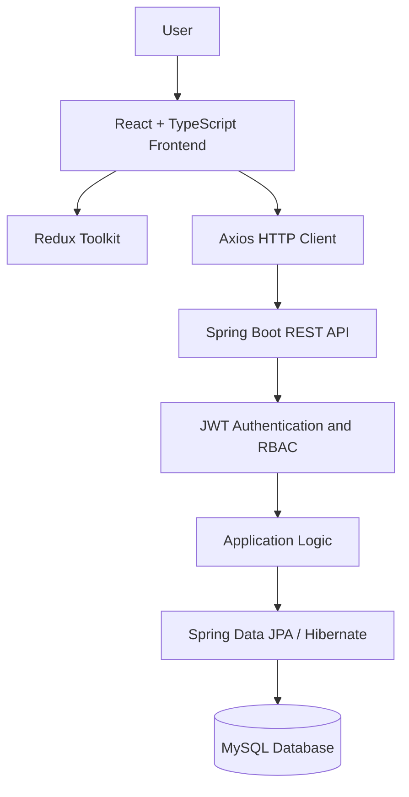

# OrderFlow WMS

### A Full-Stack Warehouse Management System

**Manage warehouses. Track inventory. Process orders. Coordinate fulfillment.**

OrderFlow WMS is a full-stack warehouse management application designed to bring essential warehouse operations into one connected system. It combines a responsive React and TypeScript interface with a Java Spring Boot REST API, relational data persistence, and role-based access control.

<p align="center">
  <a href="https://orderflow-frontend-gu1d.onrender.com"><strong>🚀 Live Demo</strong></a>
  &nbsp; • &nbsp;
  <a href="https://orderflow-backend-p17p.onrender.com/swagger-ui/index.html"><strong>📘 API Documentation</strong></a>
  &nbsp; • &nbsp;
  <a href="https://github.com/daksh8492/OrderFlow-Frontend"><strong>Frontend Source</strong></a>
  &nbsp; • &nbsp;
  <a href="https://github.com/daksh8492/OrderFlow-Backend"><strong>Backend Source</strong></a>
</p>

<p align="center">
  
  
  
  
  
</p>

---

## Table of Contents

- [Overview](#overview)
- [Live Demo](#live-demo)
- [Features](#features)
- [Application Architecture](#application-architecture)
- [Technology Stack](#technology-stack)
- [Authentication and Security](#authentication-and-security)
- [Project Repositories](#project-repositories)
- [Getting Started](#getting-started)
- [API Documentation](#api-documentation)
- [Engineering Highlights](#engineering-highlights)
- [Roadmap](#roadmap)
- [Author](#author)

---

## Overview

Warehouse operations involve more than storing products. Inventory must be organized, stock levels maintained, customer orders processed, and shipments coordinated across different operational roles.

**OrderFlow WMS brings these responsibilities into a unified application.**

The project is built around a full-stack architecture in which the frontend communicates with a Spring Boot backend through REST APIs, while the backend handles application logic, authorization, and database persistence.

### What the system brings together

| Operational area | Purpose |
|---|---|
| Warehouse management | Organize warehouse records and locations |
| Inventory management | Manage items and warehouse stock |
| Order management | Maintain customer orders and related records |
| Picking and packing | Support order fulfillment workflows |
| Shipment management | Manage shipment-related operations |
| User management | Organize application users and role-based access |
| Vendor and customer management | Maintain related business records |

The application is designed with separate frontend and backend repositories, allowing the user interface and API to be developed and deployed independently.

## Live Demo

**Explore the deployed application:**

- **Application:** [Open OrderFlow WMS](https://orderflow-frontend-gu1d.onrender.com)
- **API:** [Open the backend service](https://orderflow-backend-p17p.onrender.com)
- **API reference:** [Swagger UI](https://orderflow-backend-p17p.onrender.com/swagger-ui/index.html)

### Demo credentials

| Field | Value |
|---|---|
| User code | `USR-0001` |
| Password | `USR-0001` |

> **Demo account:** These credentials are intended for project evaluation. Use only the designated demo environment, and never enter confidential or real business data. The hosted services may take time to wake up or may occasionally be unavailable.

---

## Features

### 1. Warehouse and inventory operations

- Manage warehouse and storage-location records.
- Organize inventory-related information.
- Maintain item, vendor, and warehouse data.
- Access warehouse-stock functionality through dedicated application modules.

### 2. Order fulfillment

- Manage customers and order records.
- Work with picking and packing functionality.
- Maintain shipment-related records.
- Connect frontend operations to backend APIs.

### 3. Role-based application access

The application defines four roles:

| Role | Intended responsibility |
|---|---|
| `ADMIN` | Administrative operations |
| `INVENTORY_MANAGER` | Inventory and warehouse operations |
| `WAREHOUSE_OPERATOR` | Warehouse-floor operations |
| `DRIVER` | Delivery and shipment-related operations |

Available actions depend on the permissions implemented for each role.

### 4. Structured frontend

- React and TypeScript for a component-based interface.
- Redux Toolkit for shared application state.
- React Router for navigation and protected routes.
- React Hook Form and Zod for form handling and validation.
- Reusable UI components and consistent styling.

### 5. RESTful backend

- Spring Boot-based API architecture.
- Spring Data JPA and Hibernate for persistence.
- DTO and model-mapping support.
- JWT-based authentication and authorization.
- Interactive API documentation through Swagger UI.

---

## Application Architecture

OrderFlow follows a client-server architecture with clearly separated presentation, application, and persistence layers.



### Request lifecycle

1. A user interacts with the frontend.
2. The frontend sends an HTTP request to the backend API.
3. The backend applies authentication and authorization where required.
4. Application logic processes the request.
5. The persistence layer reads or updates database records.
6. The API returns a response that the frontend uses to update the interface.

This separation keeps the UI independent of database access and gives the backend responsibility for enforcing application rules.

---

## Technology Stack

### Frontend

| Technology | Role |
|---|---|
| React | User interface |
| TypeScript | Static typing |
| Vite | Development server and build tooling |
| Redux Toolkit | State management |
| React Router | Client-side routing |
| Axios | HTTP communication |
| React Hook Form | Form handling |
| Zod | Schema validation |
| Tailwind CSS | Styling |
| Radix UI and shadcn/ui | Reusable interface components |
| Lucide React | Icons |

### Backend

| Technology | Role |
|---|---|
| Java | Primary programming language |
| Spring Boot | Backend application framework |
| Spring MVC | REST endpoints |
| Spring Data JPA | Data access |
| Hibernate | ORM |
| MySQL | Relational database |
| JWT | Token-based authentication |
| BCrypt | Password hashing |
| MapStruct and ModelMapper | Object mapping |
| Lombok | Boilerplate reduction |
| Maven | Build and dependency management |
| springdoc-openapi | API documentation |

---

## Authentication and Security

Security is part of the application's architecture rather than being limited to the login screen.

- **JWT authentication:** Access-token-based authentication with refresh-token handling.
- **Role-based access control:** The backend supports the application's defined user roles.
- **Password hashing:** BCrypt is used for password hashing.
- **Protected routes:** The frontend separates protected application areas from public routes.
- **Environment-based configuration:** Deployment-specific values and secrets should be supplied through environment variables.
- **API-driven communication:** The frontend communicates with the backend rather than connecting directly to the database.

> The frontend is not a substitute for backend authorization. Protected operations must be validated by the server.

---

## Project Repositories

OrderFlow is maintained in two repositories, with this repository serving as the combined project overview.

### Frontend — OrderFlow-Frontend

**Repository:** [github.com/daksh8492/OrderFlow-Frontend](https://github.com/daksh8492/OrderFlow-Frontend)

Contains the React and TypeScript application, UI components, feature modules, state management, routing, forms, and API integration.

### Backend — OrderFlow-Backend

**Repository:** [github.com/daksh8492/OrderFlow-Backend](https://github.com/daksh8492/OrderFlow-Backend)

Contains the Spring Boot application, REST API, authentication, authorization, persistence layer, and backend configuration.

---

## Getting Started

You can run the frontend and backend independently on your local machine.

### Prerequisites

- Git
- Node.js and npm
- JDK compatible with the backend project configuration
- MySQL
- Maven, or the Maven Wrapper included in the backend repository

### 1. Clone and configure the backend

```bash
git clone https://github.com/daksh8492/OrderFlow-Backend.git
cd OrderFlow-Backend
```

Create the local database if required:

```sql
CREATE DATABASE order_flow;
```

Configure the database connection and authentication settings using the environment variables supported by the backend's `application.properties`.

For a local MySQL installation, the database URL typically follows this format:

```text
jdbc:mysql://localhost:3306/order_flow
```

Set the database username and password and the required JWT secret and token configuration. Do not commit real credentials or secrets.

Run the application using the Maven Wrapper.

**Windows:**

```bat
mvnw.cmd spring-boot:run
```

**macOS/Linux:**

```bash
./mvnw spring-boot:run
```

The application typically starts on `http://localhost:8080`, unless configured otherwise.

### 2. Clone and configure the frontend

Open a second terminal:

```bash
git clone https://github.com/daksh8492/OrderFlow-Frontend.git
cd OrderFlow-Frontend
npm install
```

Check the repository for its environment-variable example and configure the frontend's API base URL to point to your local backend.

Start the development server:

```bash
npm run dev
```

Vite will print the local development URL in the terminal, typically `http://localhost:5173`.

### 3. Build the frontend

```bash
npm run build
```

Run the configured lint checks with:

```bash
npm run lint
```

> **Configuration note:** Environment-variable names, database defaults, and server settings should be verified against the current files in each repository. This keeps local setup aligned with the actual implementation.

---

## API Documentation

OrderFlow's backend exposes REST APIs for its application modules and provides interactive API documentation.

**[Open the deployed Swagger UI →](https://orderflow-backend-p17p.onrender.com/swagger-ui/index.html)**

Use the API reference to inspect the available endpoints, HTTP methods, request parameters, and response schemas.

If the hosted service is unavailable, start the backend locally and check the Swagger UI path configured by the project.

---

## Engineering Highlights

This project brings together several important full-stack engineering concerns:

- **Frontend-backend separation:** Two independently maintained codebases communicate through REST APIs.
- **Typed frontend development:** TypeScript provides explicit types across UI components and application logic.
- **Centralized state management:** Redux Toolkit organizes shared client-side state.
- **Form validation:** React Hook Form and Zod support structured form workflows.
- **Relational persistence:** Spring Data JPA and Hibernate connect application logic to MySQL.
- **Authentication and authorization:** JWT handling and role-based access support controlled application access.
- **Deployment configuration:** The frontend and backend are deployed separately, with environment-specific settings.

These are the architectural and implementation areas worth exploring in the linked source repositories.

---

## Roadmap

Potential future improvements include:

- Add automated integration tests for important inventory and order workflows.
- Add CI checks for frontend builds and backend tests.
- Expand operational reporting and inventory insights.
- Introduce structured logging and improved monitoring.
- Document key workflows with sequence diagrams and API examples.

These items represent possible future work rather than features claimed to be complete.

---

## About the Developer

**Daksh Tomar** — B.Tech Information Technology, 2026

OrderFlow WMS was developed as a full-stack software engineering project, combining frontend development, backend API design, database persistence, authentication, and deployment.

- **GitHub:** [@daksh8492](https://github.com/daksh8492)
- **Frontend repository:** [OrderFlow-Frontend](https://github.com/daksh8492/OrderFlow-Frontend)
- **Backend repository:** [OrderFlow-Backend](https://github.com/daksh8492/OrderFlow-Backend)

---

<div align="center">

### OrderFlow WMS

**One application. Connected warehouse workflows.**

If you find the project interesting, consider starring the repositories.

</div>
